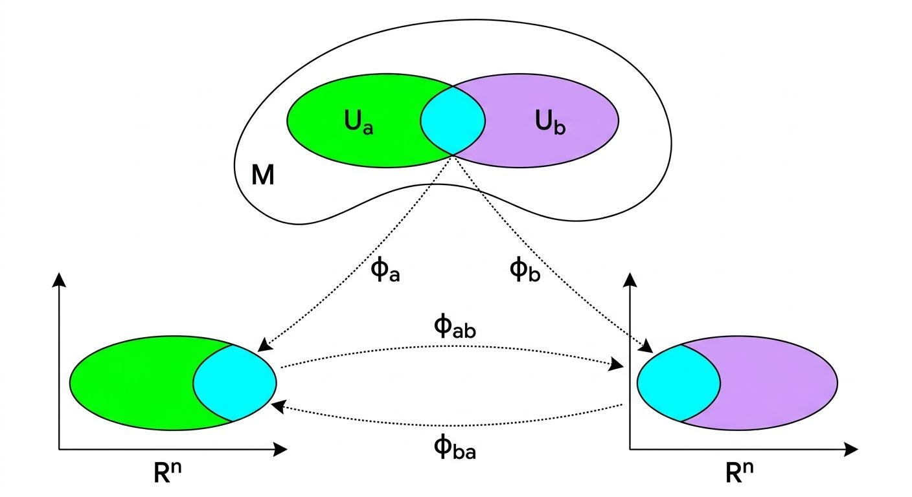

# What is a Manifold in Topology?

A **topological manifold** of dimension $n$ (an **$n$-manifold**) is a topological space that locally resembles $n$-dimensional Euclidean space $\mathbb{R}^n$, even though its global shape can be curved, twisted, or closed.

The standard textbook definition requires a space $M$ to satisfy three conditions:

1. **Locally Euclidean:** Every point $p \in M$ has an open neighborhood $U$ that is homeomorphic to an open subset of $\mathbb{R}^n$.

2. **Hausdorff:** Any two distinct points in $M$ can be separated by disjoint open neighborhoods (prevents pathological "non-separated" point duplicates).

3. **Second-countable:** The topology has a countable basis (prevents overly large or disconnected components that break standard geometric and analytical tools).

---

### Coordinate Charts and Atlases

Because a curved or closed space usually cannot be flattened into $\mathbb{R}^n$ all at once without distortion or tearing, topologists cover it with overlapping local patches:

* **Chart:** A pair $(U, \varphi)$ where $U \subseteq M$ is open and $\varphi : U \to V \subseteq \mathbb{R}^n$ is a homeomorphism onto an open set $V$ in Euclidean space. It assigns local coordinates $(x^1, \dots, x^n)$ to points in $U$.
* **Atlas:** A collection of charts whose domains cover all of $M$.
* **Transition maps:** Where two chart domains $U_a$ and $U_b$ overlap, the map $\varphi_b \circ \varphi_a^{-1}$ translates coordinates from one chart to the other on $\mathbb{R}^n$.

---

### From Topological to Smooth Manifolds

A purely **topological manifold** only preserves continuity and homeomorphisms—you cannot yet take derivatives or define tangent vectors on it.

* If the transition maps $\varphi_b \circ \varphi_a^{-1}$ are infinitely differentiable ($C^\infty$), the atlas defines a **smooth manifold** (or differentiable manifold).
* Smoothness lets you define tangent spaces, differential forms, flows, and curvature—forming the foundation of differential geometry, Lie groups, and general relativity.

---

### Examples and Non-Examples

| Space | Dimension | Status | Reason |
| --- | --- | --- | --- |
| Circle $S^1$ | $1$ | Manifold | Every small arc is homeomorphic to an open interval in $\mathbb{R}^1$. |
| Sphere $S^2$ | $2$ | Manifold | Small patches look like open disks in $\mathbb{R}^2$ (e.g., stereographic projection). |
| Torus $T^2$ | $2$ | Manifold | Locally $\mathbb{R}^2$; globally $S^1 \times S^1$. |
| Figure-eight | — | **Not** a manifold | At the crossing point, no neighborhood is homeomorphic to an open interval in $\mathbb{R}^1$. |
| Two intersecting planes | — | **Not** a manifold | Along the line of intersection, neighborhoods branch into four half-planes rather than $\mathbb{R}^2$. |

*(Note: Spaces with edges, such as a closed disk, are **manifolds with boundary**, where boundary points have neighborhoods modeled on the closed upper half-space $\mathbb{H}^n$.)*

